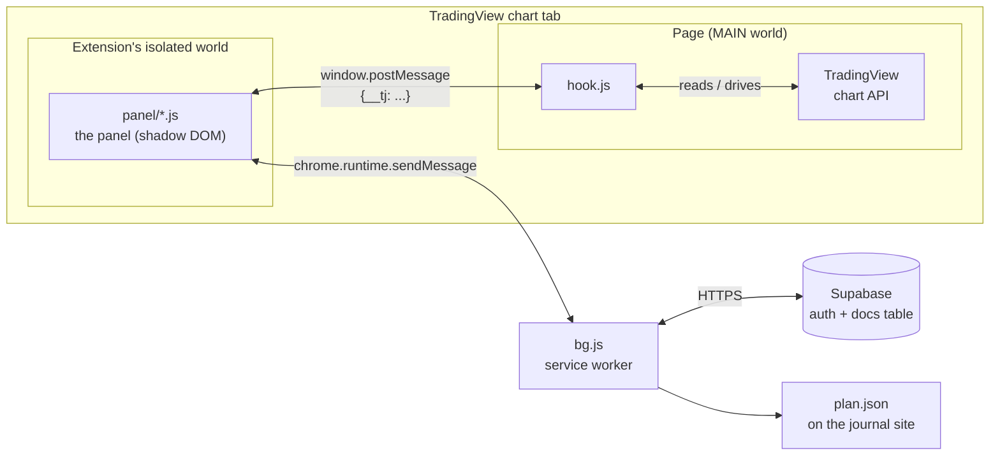

# Architecture

A Manifest V3 browser extension that adds a panel to TradingView charts and saves trades into the [Trade Journal](https://github.com/DashicleDev/TradeJournal). Plain JavaScript, no framework and no build step.

## Three parts, three worlds

A browser extension's code runs in separate places that can't share variables, so the extension is split along those lines:

| Part | Runs in | Why there | Does |
|---|---|---|---|
| `hook.js` | the TradingView page itself (`"world": "MAIN"`) | only the page can reach `window.TradingViewApi` | reads symbol, timeframe, replay date, Long/Short positions and drawing styles; switches timeframe; steps bar replay; toggles auto scale; catches snapshot links |
| `panel/*.js` | the extension's isolated world | can use extension APIs and stays out of TradingView's scripts | the UI: start screen, step-by-step logging, settings |
| `bg.js` | the extension's service worker | the only part that talks to the network, and it keeps running without a chart open | sign-in, loading projects/accounts/settings, saving trades, fetching `plan.json`, reload after update, candle-close notifications (`chrome.alarms` + `chrome.notifications`) |

The panel lives in a shadow root, so TradingView's CSS and the panel's CSS never affect each other. It ships its own font for the same reason.

## Messages

**Panel ↔ hook** use `window.postMessage` with a `__tj` field (see the table at the top of `hook.js`): `ask`/`info` for chart info, `tf`/`tfok` to switch timeframe, `pos`/`posinfo` and `posshow`/`posshown` for Long/Short positions, `sig`/`sigok` to read a drawing's style, `fwd`/`fwdst`/`fwdstop` to skip in bar replay, and `snap` when TradingView creates a snapshot link.

**Panel → background** use `chrome.runtime.sendMessage({type, ...})` through the `call()` helper in `panel/core.js`, : `status`, `login`, `logout`, `plan`, `projects`, `accounts`, `jsettings` (the journal's look), `extLoad`/`extSave` (extension settings), `save` (a trade) and `reload`.

## The panel's files

They are plain content scripts loaded in order (see `manifest.json`); they share one scope, so a file can use anything defined in a file before it.

| File | What it does |
|---|---|
| `panel/styles.js` | The panel's CSS |
| `panel/core.js` | Messaging helper, journal look (themes/accents), settings sync, local storage |
| `panel/shell.js` | The TJ button and panel, dragging, reading the chart, taking snapshots |
| `panel/position.js` | Long/Short Position tool and "skip to drawing" |
| `panel/steps.js` | The logging flow per timeframe, the trade document, invest exits, saving |
| `panel/render.js` | HTML for every screen |
| `panel/events.js` | Clicks, inputs, keyboard |
| `panel/boot.js` | Start-up: plan, projects, accounts, restore state, sign-in |

## Data

Trades are written to the journal's `docs` table in exactly the format the journal's own forms use, with the user's own session, so row-level security applies just as in the app. The extension's settings are a document of kind `extsettings` in the same table, so they follow the user to another browser. The field lists (concepts, criteria, exits) come from the journal's `plan.json`; `plan-default.js` is a built-in copy used only when that can't be fetched.

## Skip to drawing (bar replay)

`fwd` in `hook.js`: collect the drawings that match the chosen styles (horizontal lines, rays, rectangles; matched on tool, colours and text), switch to 4H, then step replay one candle at a time and check the last candles against those price levels, stopping at the first touch or at the next daily/weekly close (17:00 New York). Auto scale is on while skipping and restored afterwards; without a hit the chart goes back to the timeframe you started on.

## Releases

Bump `version` in `manifest.json`, add a section to `CHANGELOG.md`, commit and push. Users update by replacing the folder (or `git pull`) and clicking ⟳ in the panel.
